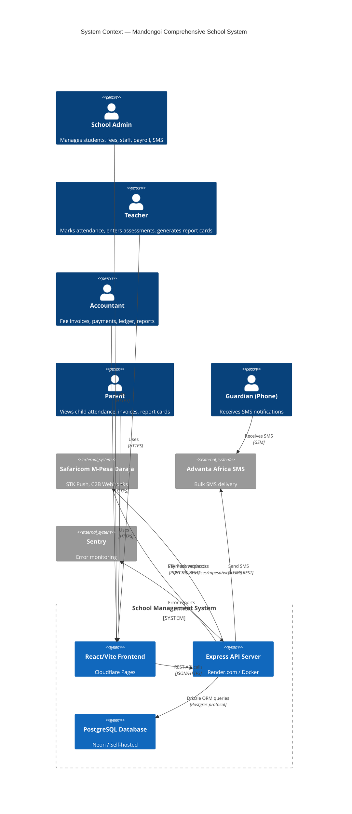
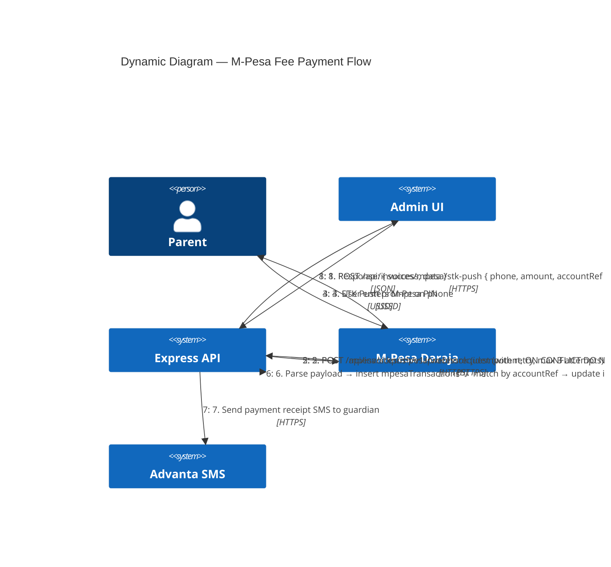
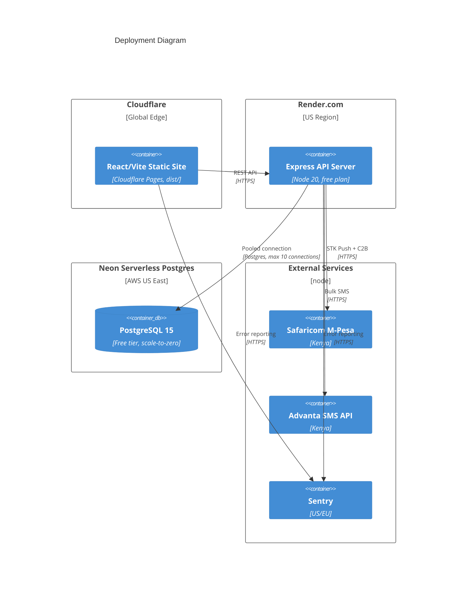
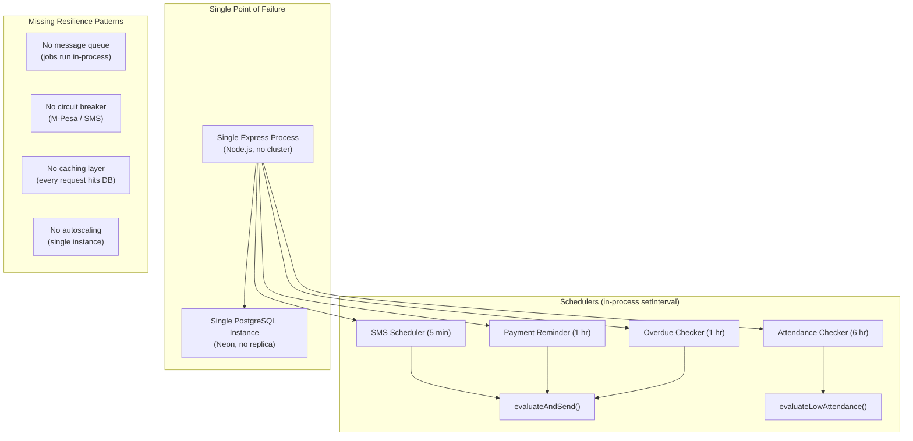

```mermaid
C4Container
  title Container Diagram — Backend Components

  Person(admin, "School Admin")
  Person(parent, "Parent")

  System_Boundary(backend, "API Server (Node/Express)") {
    Container(web, "Express HTTP Server", "Node.js + Express 4", "Routes, middleware, auth, rate limiting")
    Container(schedulers, "Background Schedulers", "In-process setInterval", "SMS reminders, overdue checks, attendance checks, payment reminders")
    ContainerDb(pg, "PostgreSQL", "Neon / Local", "26 tables: users, students, fees, ledger, payroll, SMS, attendance, etc.")

    Boundary(services, "Business Logic Services") {
      Container(fees, "Fee Service", "fees.ts", "Invoice generation, payment matching, balance tracking")
      Container(mpesa_svc, "M-Pesa Service", "mpesa.ts", "STK Push initiation, webhook parsing, retry logic")
      Container(sms_svc, "SMS Service", "sms.ts", "Template rendering, send orchestration, opt-out enforcement")
      Container(ledger, "Ledger Service", "ledger.ts", "Double-entry journal posting, trial balance")
      Container(payroll, "Payroll Service", "payroll.ts", "Run creation, entry generation, approval workflow")
      Container(auth_svc, "Auth Service", "auth.ts middleware", "JWT verification, RBAC enforcement")
    }
  }

  Rel(admin, web, "HTTP requests", "HTTPS")
  Rel(parent, web, "HTTP requests", "HTTPS")
  Rel(web, services, "Delegates to")
  Rel(services, pg, "Drizzle ORM", "SQL")
  Rel(schedulers, services, "Triggers periodic jobs")
  Rel(mpesa_svc, "Safaricom M-Pesa", "STK Push")
  Rel(mpesa_svc, "Safaricom M-Pesa", "C2B Webhook")
  Rel(sms_svc, "Advanta SMS API", "HTTPS POST")
```







---
## Architecture Notes

### Single Points of Failure
- Single Express process — if it dies, the entire API + all schedulers die
- Single PostgreSQL instance — no read replicas, no failover
- No process supervisor (PM2/systemd) in Dockerfile CMD

### External Dependencies
| Service | Protocol | Failure Mode |
|---------|----------|-------------|
| M-Pesa Daraja | HTTPS REST | STK push has retry (3 attempts, exponential backoff + jitter). Webhook is inbound (Safaricom calls us) — if we're down, payment still processes on M-Pesa side, webhook retries later |
| Advanta SMS | HTTPS REST | Single attempt, no retry. Failure is logged but not retried |
| Sentry | HTTPS | Non-blocking — failure to report doesn't affect app |

### Data Flow
1. User → Cloudflare Pages (React SPA) → HTTPS API calls → Render Express API
2. Express validates JWT (authMiddleware) → enforces role (requireRole) → calls service → queries PostgreSQL via Drizzle
3. Fee payment flow: Admin initiates STK Push → Backend calls M-Pesa API → User enters PIN on phone → M-Pesa calls webhook → Backend idempotently processes payment → Updates invoice/ledger → Sends SMS receipt
